# DersTakip Akademi

Özel ders veren öğretmenler ve eğitim kurumları için geliştirilmiş öğrenci takip, ders planlama ve veli bilgilendirme platformu. Öğretmenlerin günlük operasyonlarını tek panelden yürütmesini; velilerin ise öğrencilerinin gelişimini güvenli biçimde takip etmesini sağlar.

## Öne çıkan özellikler

- Öğrenci, veli ve grup yönetimi
- Haftalık ders takvimi, bireysel/grup ders planlama ve tekrarlayan dersler
- Yoklama kaydı, ders notları ve veliye açık notlar
- Kitap okuma takibi ile aylık ilerleme grafikleri
- Deneme sınavı sonuçları, net hesaplama ve gelişim analizi
- Tahsilat, borç ve ödeme geçmişi takibi
- Veliye özel mobil uyumlu portal ve Web Push bildirim tercihleri
- PWA desteği ile cihazlara kurulabilen deneyim

## Teknoloji yığını

- Next.js 16 ve React 19
- TypeScript
- Tailwind CSS 4
- Prisma ORM ve PostgreSQL (Supabase ile uyumlu)
- NextAuth.js ile rol tabanlı oturum yönetimi
- Recharts ile grafikler

## Başlarken

### Gereksinimler

- Node.js 20 veya üzeri
- PostgreSQL veritabanı ya da Supabase PostgreSQL projesi

### Kurulum

```bash
npm install
Copy-Item .env.example .env
```

`.env` dosyasındaki `DATABASE_URL`, `DIRECT_URL`, `NEXTAUTH_URL` ve `NEXTAUTH_SECRET` değerlerini kendi ortamınıza göre düzenleyin. Bildirim kullanacaksanız VAPID alanlarını da doldurun.

```bash
npx prisma generate
npx prisma migrate dev
npm run dev
```

Uygulama varsayılan olarak [http://localhost:3000](http://localhost:3000) adresinde çalışır.

### Kalite kontrolleri

```bash
npm run lint
npm run build
```

## Ekran görüntüleri

### Genel, giriş ve kayıt

| Ana sayfa | Veli kaydı |
| --- | --- |
| 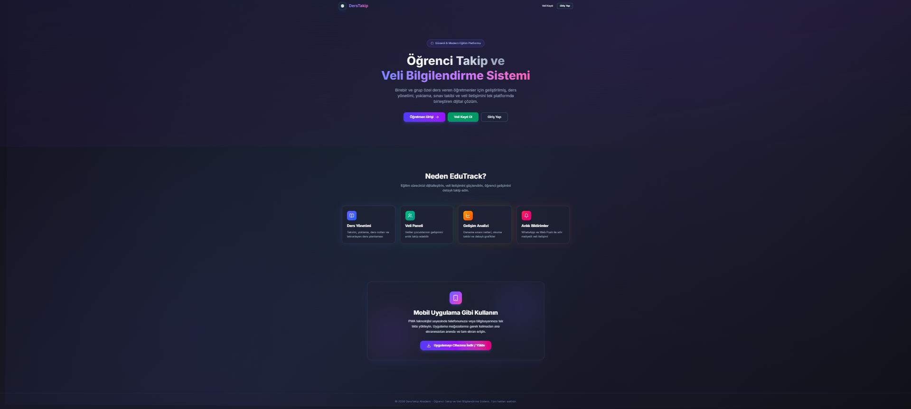 | 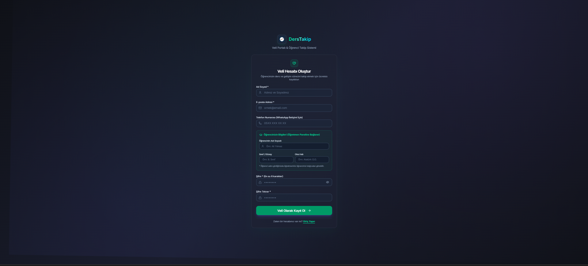 |

| Giriş |
| --- |
|  |

### Öğretmen paneli

| Panel özeti | Ders takvimi |
| --- | --- |
| 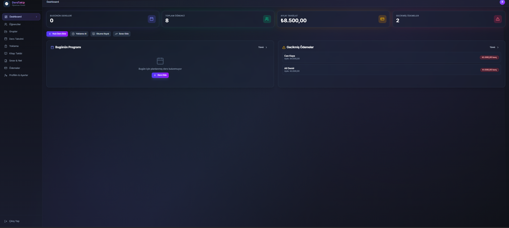 | 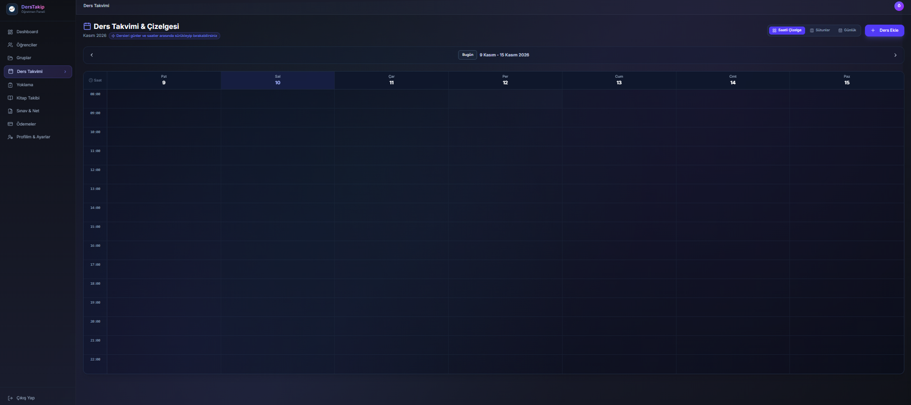 |

| Ders planlama | Öğrenciler |
| --- | --- |
| 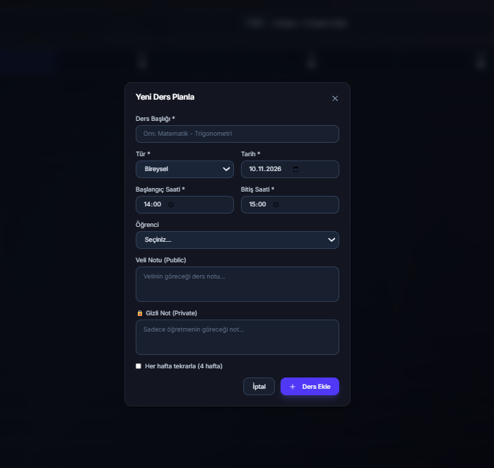 | 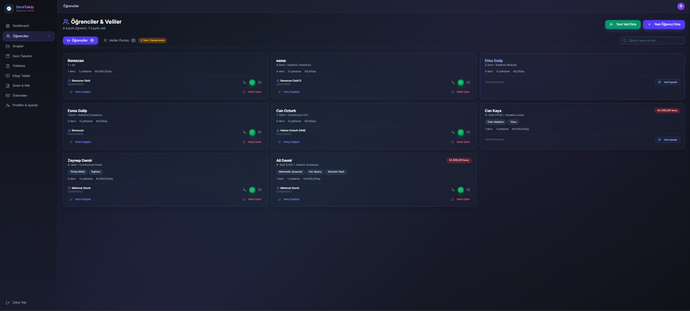 |

| Yeni veli | Yeni öğrenci |
| --- | --- |
| 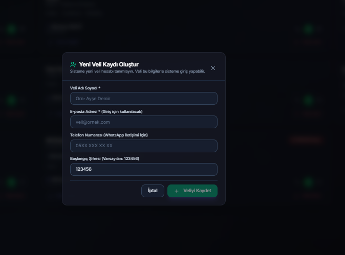 | 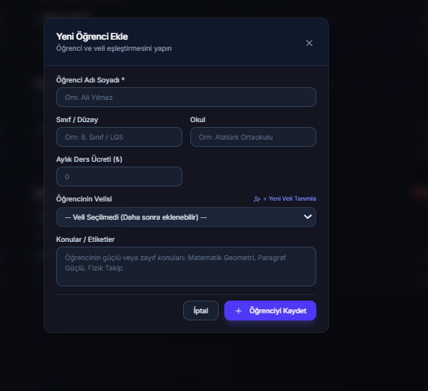 |

| Gruplar | Grup oluşturma |
| --- | --- |
| 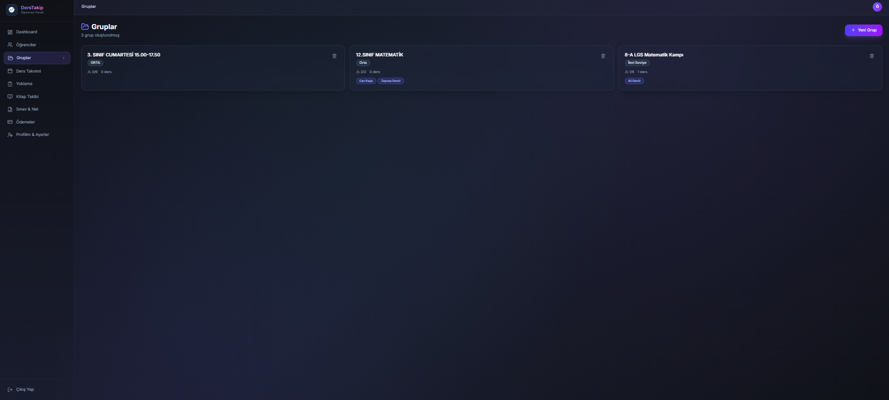 | 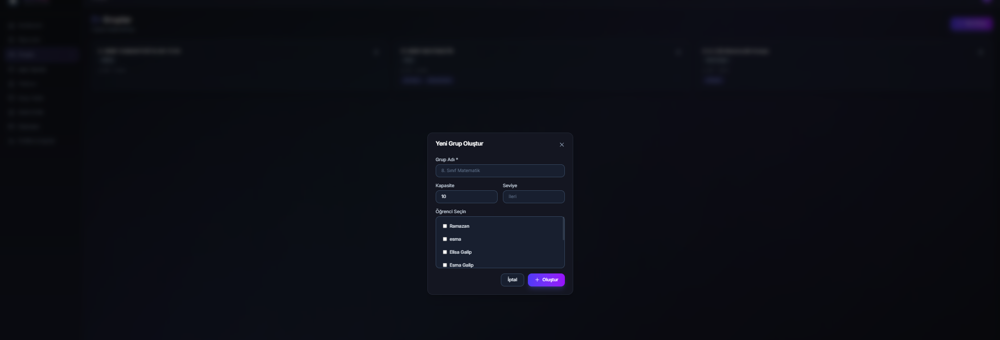 |

| Yoklama | Yoklama ve ders ekleme |
| --- | --- |
| 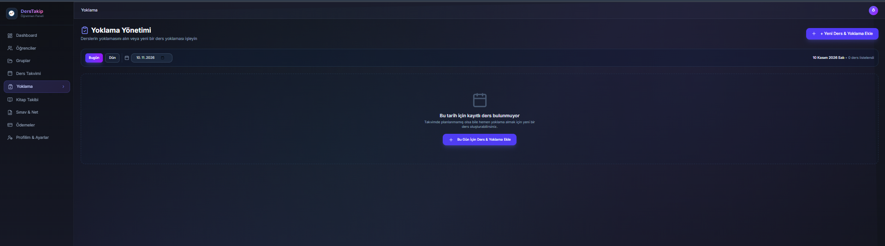 | 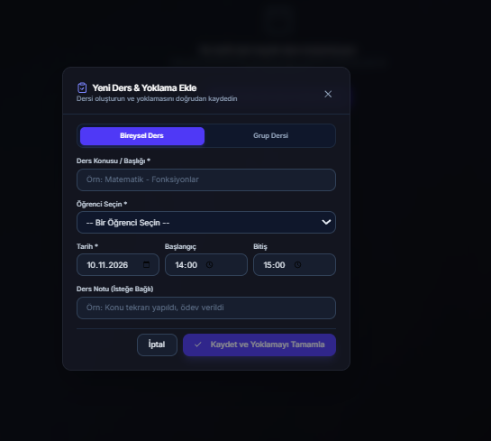 |

| Kitap takibi | Sınav ve net analizi |
| --- | --- |
| 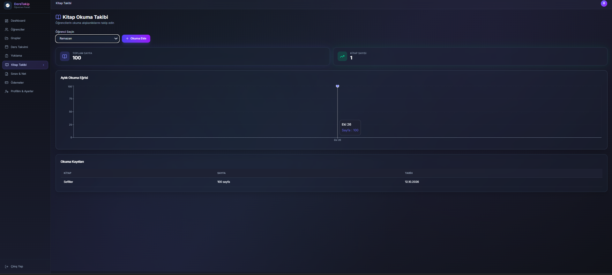 | 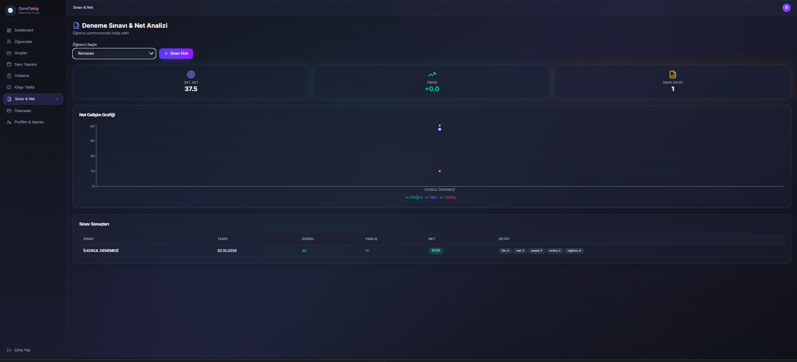 |

| Ödeme ve kasa takibi | Öğretmen profili |
| --- | --- |
| 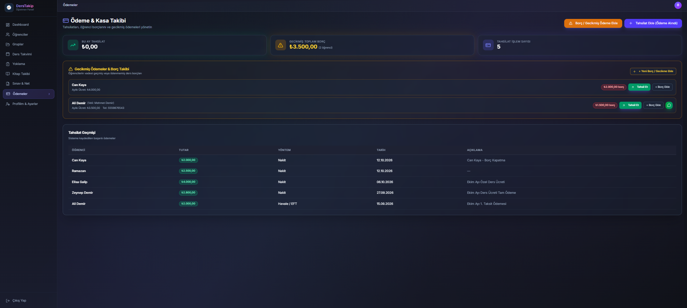 | 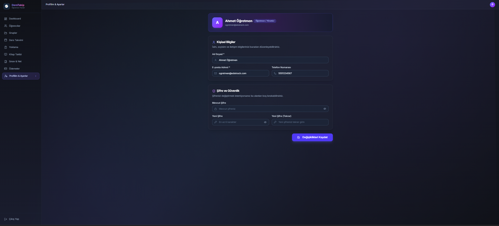 |

### Veli portalı

| Ana sayfa | Kitap okuma takibi |
| --- | --- |
| 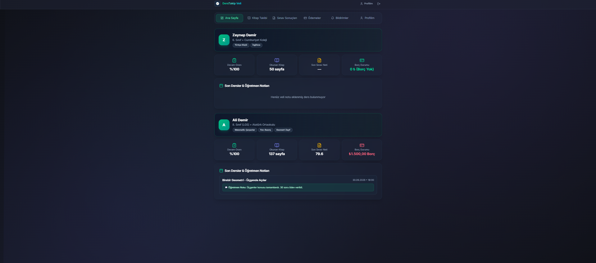 | 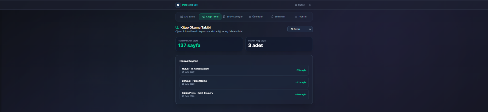 |

| Sınav sonuçları | Ödeme geçmişi |
| --- | --- |
| 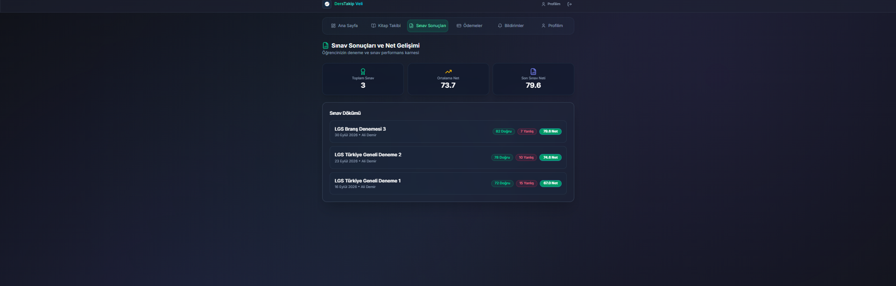 | 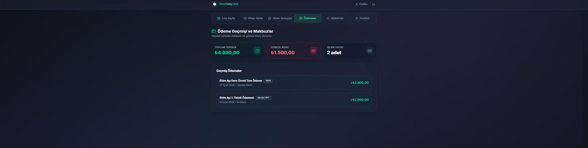 |

| Bildirim tercihleri | Veli profili |
| --- | --- |
| 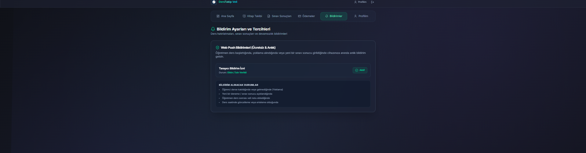 | 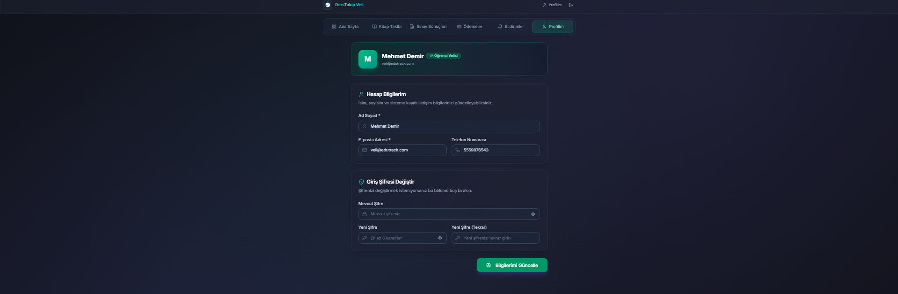 |

## Geliştirici

Bu sistem [VisionDevStudio](https://visiondevstudio.com.tr/) tarafından geliştirilmiştir.
